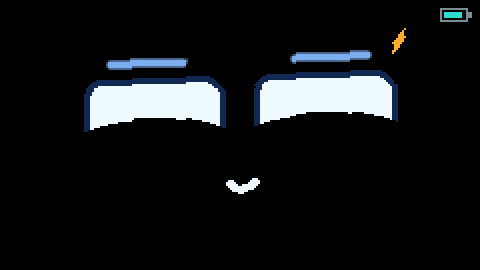

# Sila

<p align="center"></p>

**Sila** (صلة) means *connection* or *bond*. It's a little companion for the
M5StickS3 that lives on your keys, feeds on the WiFi connections around it,
and has a face, moods, a life story and a personality.

Made by **Mohanad**. The name is written in two colours, one for each side of
the connection: **si** in teal (you) and **la** in terracotta (the pet).

It started as a port of [TamaFi](https://github.com/cifertech/TamaFi) by
CiferTech (MIT), and keeps its idea of a WiFi-fed pet and parts of its stat
logic. Everything else - face, motion, sleep, colours, menus - is new.

## Flashing

Easiest, no install needed:

1. Download **`Sila.bin`** from the latest [release](../../releases/latest).
2. Open https://espressif.github.io/esptool-js/ in Chrome/Edge, plug in the StickS3 and click Connect.
3. Flash `Sila.bin` at address **0x0** - for first installs *and* updates.

- Your pet survives updates: it keeps a backup copy in a part of the flash that
  firmware files never touch, and restores itself after flashing.
- Don't tick "erase flash" (that wipes the backup too).
- Check the address box says **0x0** - the flasher defaults to 0x1000, which bricks the boot
  (black screen, USB keeps reconnecting). Re-flashing at 0x0 fixes it.

Or build it yourself with PlatformIO in VS Code:

1. Open this folder in VS Code (File > Open Folder). PlatformIO picks up `platformio.ini`
   and downloads the ESP32-S3 toolchain plus M5Unified/M5GFX the first time.
2. Plug in the StickS3 with USB-C.
3. Click the PlatformIO **Upload** arrow (or run `pio run -t upload`).
4. Optional: click **Serial Monitor** (115200). On boot it prints the board id and
   whether the IMU was found.

This replaces Bruce on the stick. To go back, flash Bruce again from its web flasher.

## Controls

| Input | Home (face) | Menus | Info pages |
|---|---|---|---|
| **A** tap | Open menu | Select / change | Back to home |
| **A** hold | Pat it (+happiness) | | |
| **B** click (side) | Quick pages: Vitals > Pet Info > WiFi | Next item | Next page |
| **B** hold | | Back | Back to home |
| **Lay it flat** (4 s, within ~10 deg of level) | Pet goes to bed; pick it up to wake it | | |
| **Rock it** side to side | Eyelids get heavy, it falls asleep in your arms. Bumps make it stir, a hard jolt or loud bang wakes it in shock | | |
| **Walk** with it | Counts steps, "walkies!", +happiness/+health every 100 steps, daily goal 3000 | | |
| **Talk / clap / music** | Listens (teal sound waves), looks at you on a clap, dances to a beat, startles at a bang | | |
| **Double clap** | "you called?" - looks at you, wakes it up happily if asleep | | |
| **Poke** its side | 1-3 pokes: giggles. 4-5: "hey!". 6+ in 8 s: grumpy "stop poking!" | | |
| **Drop / toss** it | Screams while falling. Soft catch: "wheee!". Hard landing: "ow!" + dizzy | | |
| **Plug in USB** | Eats electricity: sparks, "yum! power!", +food. Low battery: tired, "charge me!" | | |
| **Menu > PLAY** | Catch: tilt to move, catch WiFi snacks & hearts, dodge bugs. A pause, hold B back | | |
| **Turn it** | Face floats level with the world at any angle (like something in a bottle) and sways when you move it. Spin it a lot and it gets dizzy, then sick for a bit | | |

The screen stays on. It only dims while the pet is asleep in bed (laid down),
and keeps animating. Settings > Idle Screen can also dim or turn it off after
1 minute without input.

First boot: just an egg - press A or shake it to hatch. Every boot after that:
a black screen, then the eyes pop in, blink and look around.

## Colours mean something

- **Teal = you**: selection, things you control.
- **Terracotta = the pet**: its voice - hints, speech badges.
- Stats: hunger amber (food), happy pink (heart), health green (life).
- Sections: Vitals red, Pet violet, WiFi blue, Controls teal, Settings yellow,
  System slate, Home terracotta. Stages: Baby pink, Teen teal, Adult blue, Elder violet.
- Status dots: green good, amber attention, red danger.

## Senses (privacy)

- **Ears**: the microphone only measures loudness and rhythm on the stick. Nothing is
  recorded, stored or sent. Settings > Ears (mic) turns it off.
- **People radar**: a 2-second passive Bluetooth listen every 3 minutes counts devices
  close by (phones, earbuds). It never connects to anything and skips scans while
  asleep, hot or on low battery. Settings > People Radar turns it off.

## Life stages

Each stage has its own face: Baby (big round eyes with shiny pupils, rosy cheeks),
Teen (classic eyes and brows), Adult (wider, sharper eyes, thicker brows),
Elder (smaller droopy eyes, bushy brows, round glasses). Evolving shows a
sparkle celebration in the new stage's colour.

## What changed from the original TamaFi (credit)

| Original TamaFi V2 | StickS3 port |
|---|---|
| 240x240 TFT, TFT_eSPI | 240x135 landscape, M5Unified/M5GFX |
| 6 buttons | 2 buttons + motion (BMI270 IMU): poke, drop, tilt, lie down, rotate |
| Piezo buzzer | Built-in speaker (amp only powered while a sound plays) |
| 4 NeoPixels | Expressions and icons on the face instead |
| Stone golem sprites | Robot-eyes face drawn in code, rotates with the stick |
| No battery readout | Battery icon in the header |

New: poke it, double clap to call it, Catch tilt game, eats electricity when charging, hold A to pat, lie it down to sleep, auto-rotating face,
dizzy when spun, Vitals page with explanations, waking-up boot animation.

Bugs fixed from upstream:
- Evolution only looked at the minutes counter (wraps at 60), so pets never reached ADULT/ELDER.
- Sleep animation played the hatch frames in the wrong direction.
- Image data was compiled twice (in both source files), wasting about 1 MB of flash.
- `petPosX`/`petPosY` were defined in a header, which breaks linking.

## Files

```
src/main.cpp        pet logic, sound, input, persistence
src/ui.cpp          all screens (240x135), one theme
include/theme.h     colour palette
src/face.cpp        robot-eyes face (drawn with shapes, reacts to mood/WiFi)
src/senses.cpp      ears (mic), steps, rocking, people radar (BLE)
src/game.cpp        Catch, the tilt mini-game
src/backup.cpp      pet backup that survives re-flashing
include/ui.h        shared types and state
include/ui_anim.h   animation timings (from upstream)
```

## Tuning

Top of `src/main.cpp`: `SCREEN_SLEEP_MS`, `DECISION_INTERVAL_MIN/MAX`
and `HUNGER_DECAY_MS` / `HAPPY_DECAY_MS` / `HEALTH_DECAY_MS` (how fast stats drop).

Sound (Menu > Controls > Sound): **Key** = only your actions, hatching, evolving and
play; **All** = also every autonomous hunt/explore/nap like the original; **Off**.

## License

MIT, same as the original TamaFi by CiferTech that Sila grew out of (their copyright
notice is kept, as MIT requires). See `LICENSE`. All graphics in
this port are drawn in code; the original sprite art is no longer used.
